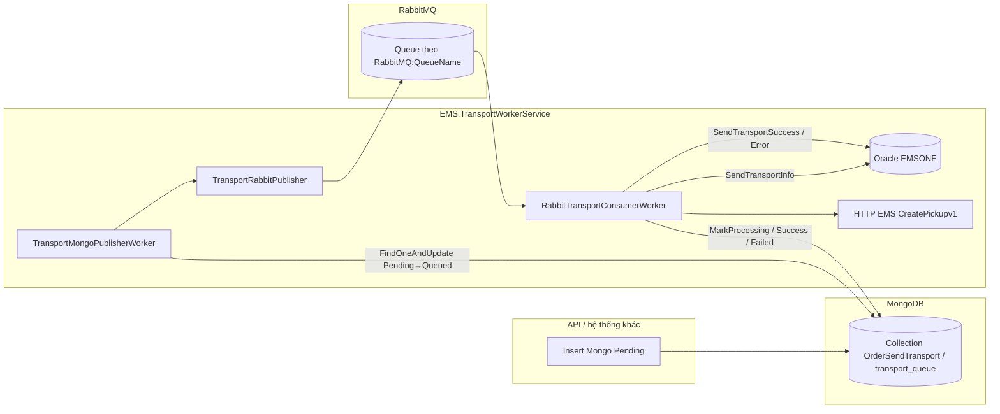

# EMS Transport Worker — Luồng chạy và giải thích code

Tài liệu này mô tả **luồng nghiệp vụ end-to-end**, **vai trò từng file/lớp**, và **điểm cấu hình** để bạn có thể tự build, mở rộng hoặc debug.

---

## 1. Mục đích

Ứng dụng là **.NET Worker Service** (chạy nền), thay thế phần “gửi vận chuyển” gọi trực tiếp từ API cũ. Luồng chính:

1. Một hệ thống khác (ví dụ API) ghi yêu cầu vào **MongoDB** (outbox) với trạng thái `Pending`.
2. Worker **A** (`TransportMongoPublisherWorker`) đọc `Pending`, chuyển sang `Queued`, **publish** JSON lên **RabbitMQ**.
3. Worker **B** (`RabbitTransportConsumerWorker`) **consume** queue, gọi **Oracle** lấy dữ liệu đơn, gọi **HTTP EMS** tạo pickup, rồi cập nhật Oracle + Mongo.

Hai hosted service chạy **song song** trong cùng một process (`Program.cs`).

---

## 2. Sơ đồ luồng (tổng quan)



**Trạng thái Mongo** (xem `Models/ZTransportQueueMongo.cs`):

| Status      | Ý nghĩa |
|------------|---------|
| `Pending`  | Chờ đẩy lên Rabbit |
| `Queued`   | Publisher đã “giữ” bản ghi và đang/sẽ publish |
| `Processing` | Consumer đang xử lý |
| `Success`  | Hoàn tất thành công |
| `Pending` (lại) / `DeadLetter` | Lỗi: retry hoặc hết `MaxRetry` |

---

## 3. Khởi động ứng dụng — `Program.cs`

- Đăng ký `HttpClient` named `EMSClient` (header `Accept: application/json`) cho gọi EMS.
- Đăng ký **Singleton**: `APILibraryRepository`, `EMSRepository`, `TransportQueueMongoRepository`, `OrderRepository`, `TransportRabbitPublisher`.
- Đăng ký **HostedService** (chạy vòng đời theo host):
  - `TransportMongoPublisherWorker`
  - `RabbitTransportConsumerWorker`
- `host.Run()` — chạy cho đến khi shutdown.

**File:** `Program.cs`

---

## 4. Nhánh Mongo → Rabbit (Publisher)

### 4.1 `TransportMongoPublisherWorker`

- Vòng lặp: mỗi ~750ms nếu không có việc.
- Gọi `_mongoRepo.GetOnePendingForQueue()`:
  - Nếu có document: build `ZTransportRabbitMessage` (`QueueId` = `_id` Mongo string, `AmndState`, `OrderID`, `ShopID`, `CreatedBy`).
  - `_rabbitPublisher.PublishAsync(message)` — nếu lỗi: `RevertToPending` + log.

**File:** `Workers/TransportMongoPublisherWorker.cs`

### 4.2 `TransportQueueMongoRepository`

- Kết nối Mongo từ `Mongo:ConnectionString`, `Mongo:DatabaseName`, `Mongo:CollectionName`.
- **`GetOnePendingForQueue`**: `FindOneAndUpdate` — filter `Status == "Pending"` và `RetryCount < MaxRetry`, update sang `Queued` + `QueuedAt` — **tránh hai publisher lấy trùng một bản ghi** (atomic).
- **`RevertToPending`**: publish Rabbit lỗi → trả về `Pending` + `LastError`.
- **`MarkProcessing` / `MarkSuccess` / `MarkFailed`**: consumer cập nhật; `MarkFailed` tăng `RetryCount`, quá `MaxRetry` → `DeadLetter`.

**File:** `Repositories/TransportQueueMongoRepository.cs`  
**Model:** `Models/ZTransportQueueMongo.cs`

### 4.3 `TransportRabbitPublisher`

- Tạo connection Rabbit qua `RabbitMqConnectionFactoryBuilder`.
- `QueueDeclare` durable, `BasicPublish` vào **default exchange**, `routingKey` = tên queue (chuẩn direct queue).
- JSON body: `TransportRabbitJson.Serialize` (**camelCase** để tương thích consumer).

**File:** `Services/TransportRabbitPublisher.cs`

---

## 5. Nhánh Rabbit → Xử lý (Consumer)

### 5.1 `RabbitTransportConsumerWorker`

**Vòng ngoài (`ExecuteAsync`)**: lặp gọi `RunRabbitConsumerSessionAsync`; nếu exception (mạng, broker) → log, delay 3s, thử lại.

**Một phiên Rabbit (`RunRabbitConsumerSessionAsync`)**:

1. Dispose connection/channel cũ (nếu có).
2. Tạo `ConnectionFactory` từ cấu hình; kết nối lại với retry 5s nếu fail.
3. Tạo channel, đăng ký `ChannelShutdownAsync` → `TaskCompletionSource` để **không thoát sớm** trước khi consumer xong (tránh race `BasicAck` “Already closed”).
4. `QueueDeclare` + `BasicQos(prefetchCount: 1)` — xử lý **tuần tự từng message**.
5. `ReceivedAsync`:
   - Deserialize `TransportRabbitJson.DeserializeTransportMessage` (thử PascalCase rồi camelCase).
   - Không parse được / thiếu `QueueId` → ack, bỏ qua.
   - `_mongoRepo.MarkProcessing(queueId)`.
   - `XCommon.SendTransportOrder(...)` — toàn bộ gọi Oracle + EMS.
   - Nếu `Code == "00"` → `OrderRepository.SendTransportSuccess`, ngược lại → `SendTransportError`.
   - `MarkSuccess` chỉ khi **cả hai** `SendTransportOrder` và cập nhật Oracle đều `Code == "00"`. `SendTransportError` trả `00` nghĩa là ghi lỗi Oracle OK — không được coi là gửi vận chuyển thành công.
   - Ngược lại → `MarkFailed` (lưu JSON gồm phản hồi gửi EMS và Oracle).
   - Cuối cùng `TryBasicAckAsync` (nuốt `AlreadyClosedException`).

**File:** `Workers/RabbitTransportConsumerWorker.cs`

### 5.2 `RabbitMqConnectionFactoryBuilder`

- Nếu có `RabbitMQ:AmqpUri` hợp lệ → dùng URI.
- Ngược lại: `HostName`, `Port`, `VirtualHost`, `UserName`, `Password`, optional SSL (`RabbitMQ:UseSsl`, `SslServerName`).

**File:** `RabbitMqConnectionFactoryBuilder.cs`

### 5.3 `TransportRabbitJson`

- Serialize consumer/publisher thống nhất; deserialize thử nhiều contract để publisher khác có thể gửi PascalCase hoặc camelCase.

**File:** `TransportRabbitJson.cs`  
**Model message queue:** `Models/ZTransportRabbitMessage.cs`

---

## 6. Luồng nghiệp vụ gửi vận chuyển — `XCommon.SendTransportOrder`

Thứ tự:

1. **`OrderRepository.SendTransportInfo`**  
   Gọi package Oracle `EMS_ORDER_PKG.SEND_TRANSPORT_INFO` (procedure + ref cursor). Map dòng đầu vào `ZOrderSendTransportInfoResponse`. Kiểm tra điều kiện đơn (trạng thái, transport, shipping code…). Trả `Code` + `Data` JSON.

2. **Chuẩn hóa dữ liệu** (giữ logic cũ từ API):
   - Gộp mã dịch vụ đặc biệt (`TMD_B`, `TMDHCM` → `TMD`).
   - Bổ sung `CVS` vào `AdditionService` khi COD + người trả cước phù hợp.
   - Ghép mô tả sản phẩm / ghi chú, tên sản phẩm + item.
   - Build một phần tử `LIST_ITEM` (`ZListItemInfoShippingRequest`) và object `ZTransportInfoShippingApiRequest` (pickup, `SignatureCode` = SHA256 từ `Security.SHA256` + `EMS:TransportKey`).

3. **`EMSRepository.EMSSendRequestTransportAsync`**  
   POST EMS endpoint `api/Pickup/CreatePickupv1` qua `APILibraryRepository.InvokeEMSAsync` (body **Newtonsoft** serialize giữ tên field PascalCase như Postman).

4. Trả `ZResponse`: `Code` `"00"` nếu EMS chấp nhận thành công.

**File:** `XCommon.cs`  
**Oracle đọc đơn:** `Repositories/OrderRepository.cs` — `SendTransportInfo`  
**Gọi HTTP EMS:** `Repositories/EMSRepository.cs` — `EMSSendRequestTransportAsync`  
**HTTP thấp:** `Repositories/APILibraryRepository.cs` — `InvokeEMSAsync` (POST dùng `StringContent` + JSON Newtonsoft)

---

## 7. Cập nhật Oracle sau khi gửi EMS

Consumer gọi:

- **`SendTransportSuccess`**: `EMS_ORDER_PKG.SEND_TRANSPORT_SUCCESS` dạng function `RETURN NUMBER` (parameter `RETURN_VALUE`), input `P_ORDER_ID`, `P_SHOP_ID`, `P_AMND_STATE`, `P_CREATED_BY`.
- **`SendTransportError`**: `EMS_ORDER_PKG.SEND_TRANSPORT_ERROR` tương tự (không có `P_CREATED_BY` theo code hiện tại).

**File:** `Repositories/OrderRepository.cs` (khoảng dòng 310–443)

---

## 8. Cấu hình (`appsettings.json` / biến môi trường Docker)

| Section | Khóa chính | Ý nghĩa |
|---------|------------|---------|
| `ConnectionStrings` | `EMSONE` | Chuỗi Oracle cho `OrderRepository` |
| `RabbitMQ` | `HostName`, `Port`, `UserName`, `Password`, `VirtualHost`, `QueueName`, `UseSsl`, `AmqpUri` | AMQP + tên queue (publisher và consumer phải **cùng queue** nếu cùng pipeline) |
| `Mongo` | `ConnectionString`, `DatabaseName`, `CollectionName` | Outbox + trạng thái xử lý |
| `EMS` | `ApiUrl`, `ApiKey`, `Authorization`, `TransportKey` | Base URL + header + chữ ký pickup |
| `SyncGateway` | `BaseUrl` | Tùy chọn; `EMSRepository.SendReceiverInforAsync` bỏ qua nếu trống |
| `Worker` | `HttpTimeoutSeconds` | Thời gian chờ tối đa mỗi request HTTP EMS (mặc định 120) |
| `Worker` | `OracleConnectionTimeoutSeconds` | Giới hạn thời gian **mở TCP** tới Oracle (gắn vào chuỗi kết nối nếu chưa có `Connection Timeout`; mặc định 30) — giảm treo sau idle trước cả `CommandTimeout` |
| `Worker` | `MaxProcessingSecondsPerMessage` | Giới hạn thời gian xử lý một message Rabbit (phần async gọi EMS + token hủy; mặc định 300, tối thiểu 30) |
| `Worker` | `StopHostOnBackgroundServiceException` | `true`: background service lỗi nặng → dừng process → Docker `restart` khởi động lại container (mặc định `true`) |

Trên Docker, .NET map biến môi trường dạng `RabbitMQ__QueueName`, `ConnectionStrings__EMSONE`, v.v.

**Gợi ý triển khai:** trong `docker-compose` giữ `restart: unless-stopped` cho worker; kết hợp `StopHostOnBackgroundServiceException` + timeout để tránh treo vô hạn trên một job và tự hồi phục khi crash toàn process.

---

## 9. Các file khác đáng biết

| File | Vai trò |
|------|---------|
| `Models/ZOrderSendTransportInfoResponse.cs` (và các `Z*` request/response) | Contract dữ liệu Oracle / EMS |
| `Security.cs` | SHA256 cho `SignatureCode` |
| `XData.cs` | Hỗ trợ map tên hiển thị (classification, consignment, order status) |
| `Worker.cs` | Có thể là template mặc định; **luồng chính không dùng file này** nếu không đăng ký trong `Program.cs` |
| `Dockerfile`, `docker-compose*.yml` | Build image và chạy cùng Rabbit/Mongo |

---

## 10. Gợi ý khi tự build / mở rộng

1. **Tách môi trường (UAT/Prod)**  
   Hai instance worker: khác `RabbitMQ:QueueName`, khác `Mongo:DatabaseName` (hoặc collection), khác `EMS:*` và `ConnectionStrings:EMSONE`. Publisher và consumer của **cùng một môi trường** phải trỏ cùng queue + cùng Mongo collection đang dùng làm outbox.

2. **Độ tin cậy**  
   Message đã ack sau khi xử lý xong (kể cả lỗi nghiệp vụ đã ghi Mongo/Oracle). Nếu cần **redelivery khi Oracle update fail**, phải thiết kế lại (ví dụ không ack, hoặc dead-letter exchange).

3. **Scale**  
   Nhiều consumer cùng một queue: Rabbit phân phối round-robin; Mongo `MarkProcessing` theo `QueueId` từ message — tránh trùng nếu mỗi message là một `_id` duy nhất. Publisher: chỉ nên chạy **một instance** hoặc dùng đúng pattern atomic hiện có (đã có `FindOneAndUpdate`).

4. **Thêm bước đồng bộ**  
   `EMSRepository.SendReceiverInforAsync` đã có sẵn cho Sync Gateway khi cấu hình `SyncGateway:BaseUrl`; có thể gọi thêm sau bước EMS trong `XCommon` hoặc trong consumer tùy nghiệp vụ.

---

## 11. Build nhanh

```bash
dotnet build
```

Chạy local (cần Mongo + Rabbit + Oracle + EMS reachable theo `appsettings` hoặc user secrets):

```bash
dotnet run --project EMS.TransportWorkerService.csproj
```

---

*Tài liệu phản ánh cấu trúc code tại thời điểm viết; khi refactor, nên cập nhật mục 2 và 4–6 cho khớp.*
