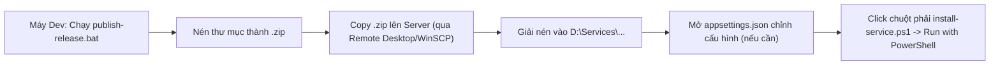

# Kế hoạch: Script tự động hóa & Chuẩn bị Server triển khai Windows Service

## 1. Tác dụng của các file Script tự động hóa là gì?

Khi triển khai một ứng dụng .NET Worker lên Windows Service theo cách thủ công, bạn phải:
1. Gõ lệnh `dotnet publish` với nhiều tham số dài dòng.
2. Mở CMD quyền Administrator, gõ lệnh `sc.exe create` (rất dễ gõ nhầm khoảng trắng sau dấu `=` khiến lệnh thất bại).
3. Gõ đường dẫn tuyệt đối thủ công (ví dụ `C:\Services\EMS.EomsCategorySyncWorker\EMS.EomsCategorySyncWorker.exe`).
4. Gõ thêm lệnh cấu hình Restart khi crash (`sc.exe failure ...`).
5. Gõ lệnh Start service.

### Lợi ích khi có các file script:
- **`publish-release.bat` (Chạy ở máy Dev):**
  - Chỉ cần double-click, script sẽ tự động compile code chế độ Release, đóng gói trọn gói toàn bộ .NET 9 Runtime (Self-contained) ra thư mục `deploy_package/` sẵn sàng copy lên server.
- **`install-service.ps1` (Chạy ở Server):**
  - Tự động kiểm tra quyền Administrator (nếu chưa có thì tự nhắc).
  - Tự động lấy thư mục hiện tại của file `.exe` (bạn đặt thư mục ở ổ `C:`, `D:`, hay `E:` script đều tự nhận diện, không cần sửa tay).
  - Nếu service cũ đang chạy: tự động stop -> gỡ bỏ -> cài đặt lại bản mới.
  - Tự động đăng ký Windows Service, đặt mô tả, cấu hình tự restart sau 60s khi bị crash, và bấm Start luôn service.
- **`uninstall-service.ps1` (Chạy ở Server khi cần gỡ):**
  - 1-click để dừng và xóa hoàn toàn service khỏi hệ thống Windows.

---

## 2. Muốn deploy lên Server thì cần chuẩn bị Server như thế nào?

Để server có thể chạy được worker này, bạn cần kiểm tra 4 điều kiện chuẩn bị sau trên Server:

### Điều kiện 1: Hệ điều hành & Quyền hạn
- **Hệ điều hành:** Bất kỳ máy Windows 64-bit nào (Windows Server 2016, 2019, 2022 hoặc Windows 10/11 Pro).
- **Quyền hạn:** Tài khoản của bạn khi đăng nhập vào server cần có quyền **Administrator** (để cài đặt và khởi động Windows Service).

### Điều kiện 2: Runtime .NET (Rất thuận tiện)
- Nhờ chế độ **Self-contained** (`--self-contained true`), toàn bộ các file thư viện cần thiết của .NET 9 đã được nén kèm sẵn vào thư mục chạy.
- **Kết quả:** **Server KHÔNG CẦN cài đặt bất kỳ phiên bản .NET 9 nào trước**, copy lên là chạy ngay!

### Điều kiện 3: Kết nối mạng (Firewall / Mạng nội bộ)
Worker cần gọi 3 hệ thống sau, trên server mở PowerShell và gõ lệnh test mạng:
1. **Oracle Database (`192.168.80.60:1521`):**
   ```powershell
   Test-NetConnection 192.168.80.60 -Port 1521
   ```
   *(Kết quả `TcpTestSucceeded : True` là OK).*
2. **MongoDB Log (`192.168.86.16:27017`):**
   ```powershell
   Test-NetConnection 192.168.86.16 -Port 27017
   ```
   *(Kết quả `TcpTestSucceeded : True` là OK).*
3. **Internet (API VNPost EOMS):**
   ```powershell
   Invoke-WebRequest -Uri "https://uat-vlp-edi.vnpost.vn" -UseBasicParsing
   ```
   *(Server cần truy cập được internet để gọi API lấy danh mục).*

### Điều kiện 4: Thư mục lưu trữ trên Server
- Tạo một thư mục riêng biệt trên server để chứa worker, ví dụ:
  - `D:\Services\EMS.EomsCategorySyncWorker` (khuyên dùng ổ D nếu có để tránh đầy ổ hệ thống C).

---

## 3. Quy trình từng bước đưa dự án lên Server (Thực tế)



1. **Ở máy dev:** Chạy lệnh publish ra thư mục `deploy_package`.
2. **Nén thư mục `deploy_package` thành file `EMS.EomsCategorySyncWorker.zip`**.
3. **Copy file zip lên Server** (qua Remote Desktop `Ctrl + C` / `Ctrl + V`, hoặc WinSCP, FileZilla, Shared Network Folder).
4. **Giải nén tại Server** vào thư mục `D:\Services\EMS.EomsCategorySyncWorker`.
5. **Mở file `appsettings.json`** kiểm tra lại IP Oracle / MongoDB của môi trường trên server.
6. **Chạy script `install-service.ps1`** (bằng quyền Administrator) -> Hoàn tất!

---

## 4. Các file Script đề xuất tạo vào Project

### [NEW] `13.EMS.EomsCategorySyncWorker/EMS.EomsCategorySyncWorker/publish-release.bat`
Script tự động publish bản Self-contained win-x64 ra thư mục `deploy_package`.

### [NEW] `13.EMS.EomsCategorySyncWorker/EMS.EomsCategorySyncWorker/install-service.ps1`
Script tự động đăng ký service trên Windows Server, tự cấu hình recovery auto-restart, tự start service.

### [NEW] `13.EMS.EomsCategorySyncWorker/EMS.EomsCategorySyncWorker/uninstall-service.ps1`
Script tự động dừng và gỡ bỏ service an toàn.

---

## 5. Xác nhận từ bạn
Bạn có đồng ý để tôi tạo bộ 3 file script này vào project `13.EMS.EomsCategorySyncWorker/EMS.EomsCategorySyncWorker` không?
